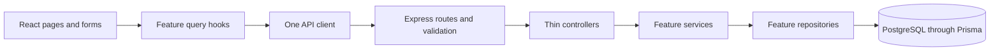
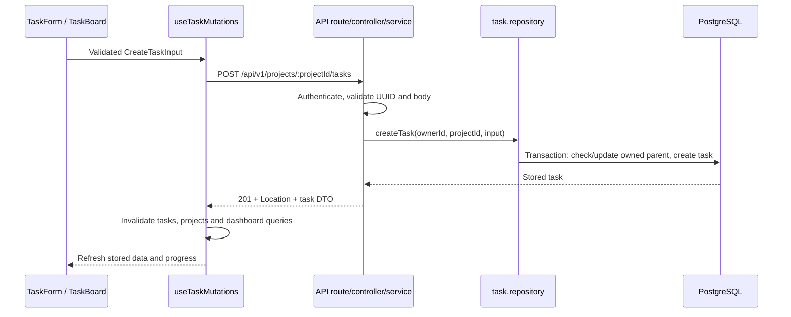
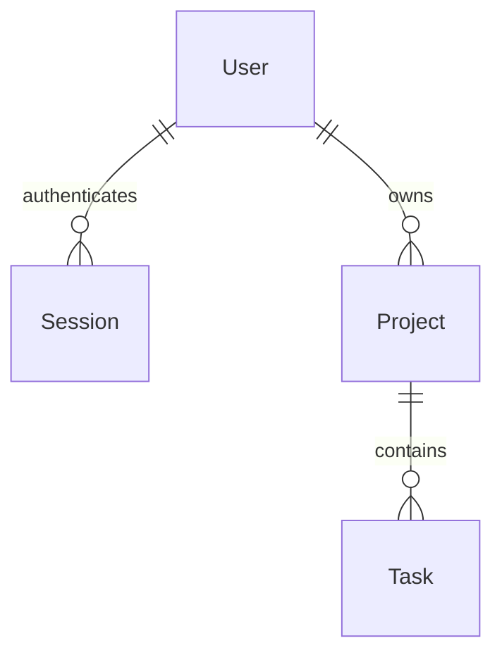
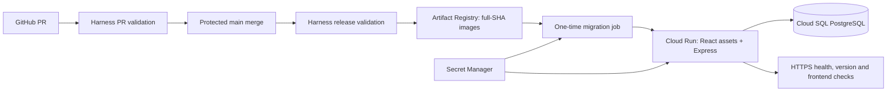

# DevTrack architecture

DevTrack is a modular monolith: one application, divided into feature modules.
React handles interaction, Express controls access and business operations, and
PostgreSQL stores durable data. This implements the V1 scope in
[PROJECT_SPEC.md](PROJECT_SPEC.md). See [DESIGN_DECISIONS.md](DESIGN_DECISIONS.md)
for the reasons and [WALKTHROUGH.md](WALKTHROUGH.md) for real request traces.

## Boundaries and dependency direction



- `apps/web/src/pages` composes screens. Feature components collect input;
  `features/*/hooks` owns server queries and mutations through TanStack Query.
- `apps/web/src/lib/api/client.ts` is the single HTTP boundary. Feature API
  modules select endpoints and shared response schemas. They do not query SQL.
- `apps/api/src/modules` contains auth, projects, tasks, dashboard, health and
  version. Routes choose middleware; controllers translate HTTP to service calls.
- Services coordinate use cases and produce public DTOs. Repositories own Prisma
  queries. Task services reuse the project repository rather than adding another
  persistence layer.
- `packages/shared/src` exports Zod contracts and inferred TypeScript types.
  It contains no browser components, Express handlers, Prisma models or secrets.
- `apps/api/src/database/prisma.ts` creates the shared database client. Generated
  Prisma code stays in the API; it is never imported into the browser bundle.

Frontend validation provides quick feedback; backend validation is authoritative.
TypeScript checks code before execution; Zod checks untrusted values at runtime.
Neither replaces database constraints or ownership checks.

## Authentication

```mermaid
sequenceDiagram
  participant B as Browser
  participant A as Express auth module
  participant D as PostgreSQL
  B->>A: POST /api/v1/auth/login (JSON)
  A->>A: Validate input and origin; rate limit
  A->>D: Find normalized email
  A->>A: Verify Argon2id password hash
  A->>D: Store SHA-256 hash of a random session token
  A-->>B: Public user + HttpOnly session cookie
  B->>A: Authenticated request with cookie
  A->>D: Find unexpired hashed token and user
  A->>A: Set response.locals.ownerId
  A->>D: Query only records owned by that user
  A-->>B: DTO response
```

The password itself is never stored. The browser receives an opaque random token;
only its hash is stored in `Session`. Sessions expire after seven days. Production
cookies are Secure, HttpOnly and SameSite=Lax. Logout deletes the matching session.
This is a database session system, not JWT authentication or OAuth.

`browser-security.ts` rejects foreign origins/cross-site mutations and requires
JSON for body-bearing mutations. The production frontend and API share an origin,
so no permissive CORS configuration is needed. HTTPS terminates at Cloud Run;
the app trusts the explicitly configured bounded proxy chain.

## Creating a task



Ownership is included in database predicates. A guessed UUID is insufficient to
read or change someone else's project/task. Missing and inaccessible resources
return the same 404. The task transaction also updates project activity, keeping
recent-project ordering useful. PostgreSQL cascades tasks when their project is
deleted; the UI requires an explicit delete confirmation.

## Data and state



See [DATABASE.md](DATABASE.md) for columns, constraints, indexes and migrations.
The dashboard uses bounded aggregate queries inside a repeatable-read transaction;
it does not load every task into Node or issue one query per project. Project
progress is derived from task counts rather than a second editable progress field.

TanStack Query owns server state. Local React state owns unsaved form values,
filters and confirmation state. Mutations invalidate related queries. Replacing
the logged-in session removes the previous account's cached data. There is no
parallel Redux store, duplicate API client, or browser-stored auth token.

## Delivery and runtime



The Dockerfile builds shared contracts, API and web assets. Its `runtime` target
serves React and `/api/v1` from one container; its separate `migrations` target
contains production migration tools. The runtime is non-root and does not run
migrations on startup. A release applies migrations once before deploying the
same published application image. No production seed runs.

CI publishes using short-lived Google OIDC access. Native CD uses the explicitly
approved limited `gcp_cd` credential fallback because the account's native GAR
reader failed OIDC token exchange. Both use the existing release identity; the
app uses a separate runtime identity. See [DEPLOYMENT_IDENTITY_PLAN.md](DEPLOYMENT_IDENTITY_PLAN.md).
The database URL remains in Google Secret Manager, referenced by numeric version.

Cloud Run scales the app to zero when idle, with maximum one instance and
concurrency four. The small managed database remains running during the trial.
These are portfolio limits, not claims of high availability or large-scale load
handling. Scaling to zero can make the first request slow. An unupgraded trial
has an expiry; this deployment is not permanent free hosting.

## Operational limits

- `/api/v1/health` proves Express liveness, not database readiness.
  `/api/v1/version` proves the running image's baked commit, not feature correctness.
- Errors have stable public codes; unexpected errors are logged safely through
  Pino. API responses return a generated `X-Request-ID`; Node's AsyncLocalStorage
  carries it into asynchronous logs without adding logging arguments to business
  functions. Completion logs include path, method, status and duration, never
  query strings, cookies or payloads. No credentials belong in logs or examples.
- Graceful shutdown stops accepting traffic and disconnects Prisma with a bounded
  deadline. PostgreSQL state survives an app container restart.
- No teams, roles, password reset, email verification, attachments, notifications,
  Kubernetes, Redis, microservices or multi-region infrastructure are added to V1.
- The app is a learning portfolio project. Automated tests and a live URL do not
  certify that its owner can explain or maintain it yet; use the study guide.
